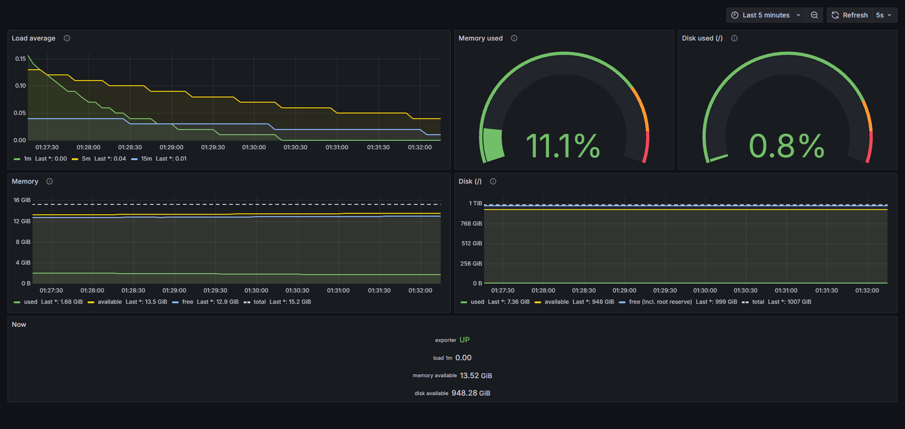

# nodeprobe

A dependency-free Linux metrics agent in Go that exposes CPU load, memory,
disk usage and network traffic in the Prometheus text format.

[](https://github.com/beratdogan6/nodeprobe/actions/workflows/ci.yml)
[](go.mod)
[](LICENSE)



## Measured numbers

A monitoring agent has to be light, or it ends up measuring itself.

| | |
| --- | --- |
| Binary size | **8,727,973 bytes** (8.3 MiB), plain `go build`, no linker flags |
| Resident memory | **7.7 MiB** at startup, **8.2 MiB** after 20 scrapes (`VmRSS` from `/proc/<pid>/status`) |
| `/metrics` response time | **0.30 ms** median over 20 requests (min 0.25 ms, max 0.52 ms) |
| Dependencies | none beyond the Go standard library |

How: built with `go build -o nodeprobe ./cmd/nodeprobe`, then the running
process was scraped 20 times with
`curl -s -o /dev/null -w '%{time_total}' localhost:9200/metrics` over loopback,
reading `VmRSS` before and after. Measured on WSL2 (kernel
`6.18.33.2-microsoft-standard-WSL2`) on Ubuntu 24.04.5, 12 CPU threads,
Go 1.27.2. A prebuilt binary was used rather than `go run`, so the compiler's
own memory use would not land in the same reading.

These are single-machine numbers on an idle host, not a benchmark suite.

## Features

- Reads the host directly, with no exporter libraries in between:
  - CPU load from `/proc/loadavg`
  - memory from `/proc/meminfo`
  - disk usage from the `statfs` syscall (the same call `df` makes)
  - network byte counters from `/proc/net/dev`, one series per interface,
    exposed as counters so Prometheus `rate()` can turn them into bytes per
    second
- Two endpoints: `GET /healthz` for liveness, `GET /metrics` for the
  Prometheus text exposition format (version 0.0.4)
- Standard library only — no third-party modules, so `go.mod` has no `require`
  block at all
- Metrics are collected per request, so a scrape always reflects the moment it
  was made

## Quick start

```sh
go run ./cmd/nodeprobe                    # listens on :9200
go run ./cmd/nodeprobe -addr 127.0.0.1:8080   # or pick the address yourself
```

`-addr` takes any Go listen address, so `127.0.0.1:9200` keeps the agent off
the network entirely. SIGINT or SIGTERM drains in-flight scrapes and exits 0.

```sh
curl localhost:9200/healthz
# ok

curl localhost:9200/metrics
# # HELP nodeprobe_load1 1-minute load average.
# # TYPE nodeprobe_load1 gauge
# nodeprobe_load1 0.21
# nodeprobe_memory_total_bytes 16322805760
# nodeprobe_memory_available_bytes 15271227392
# nodeprobe_disk_total_bytes 1081101176832
# nodeprobe_disk_used_bytes 8022470656
# nodeprobe_network_receive_bytes_total{device="eth0"} 303842249
# ... (12 metrics in all, each with its own HELP and TYPE lines)
```

To see the metrics on a dashboard, `deploy/` holds a Docker Compose stack with
Prometheus and Grafana that scrapes a locally running nodeprobe and provisions
the dashboard in the screenshot above:

```sh
cd deploy && docker compose up -d   # Grafana on :3000, Prometheus on :9090
```

See [deploy/README.md](deploy/README.md) for the details, including why
nodeprobe runs on the host rather than in a container.

## Run as a systemd service

`deploy/systemd/nodeprobe.service` runs the agent under `DynamicUser=yes` with
a read-only filesystem, no capabilities and a syscall filter — it only reads
`/proc` and calls `statfs`, so it needs nothing else.

```sh
sudo make install              # binary to /usr/local/bin, unit to /etc/systemd/system
sudo systemctl enable --now nodeprobe
```

```sh
systemctl status nodeprobe
journalctl -u nodeprobe -f
curl localhost:9200/healthz
```

`make install` runs `systemctl daemon-reload` for you. To change the listen
address, edit `ExecStart` in the unit (or drop in an override with
`sudo systemctl edit nodeprobe`) and reload. On WSL2 this needs
`systemd=true` under `[boot]` in `/etc/wsl.conf` and a `wsl --shutdown`.

## Metrics

All byte values are plain bytes. The ten host metrics are gauges; the two
network metrics are counters, repeated once per interface with a `device`
label.

| Metric | Type | Meaning |
| --- | --- | --- |
| `nodeprobe_load1` | gauge | 1-minute load average: tasks running or waiting for the CPU |
| `nodeprobe_load5` | gauge | 5-minute load average |
| `nodeprobe_load15` | gauge | 15-minute load average |
| `nodeprobe_memory_total_bytes` | gauge | Total usable memory (`MemTotal`) |
| `nodeprobe_memory_free_bytes` | gauge | Memory not used at all (`MemFree`), excluding the page cache |
| `nodeprobe_memory_available_bytes` | gauge | Memory programs can actually get (`MemAvailable`) |
| `nodeprobe_disk_total_bytes` | gauge | Size of the root filesystem |
| `nodeprobe_disk_free_bytes` | gauge | Free space, including the reserve only root may use |
| `nodeprobe_disk_available_bytes` | gauge | Space available to non-root users |
| `nodeprobe_disk_used_bytes` | gauge | Used space on the root filesystem |
| `nodeprobe_network_receive_bytes_total` | counter, label `device` | Bytes received on an interface since boot |
| `nodeprobe_network_transmit_bytes_total` | counter, label `device` | Bytes transmitted on an interface since boot |

The two network metrics are raw counters that only ever climb, so the bytes per
second are not exported but computed in Prometheus with
`rate(nodeprobe_network_receive_bytes_total[1m])`.

## How it works

```
cmd/nodeprobe/      main: -addr flag, listen, drain on SIGINT/SIGTERM
internal/collector/ reads /proc and statfs, returns typed structs
internal/metrics/    writes the Prometheus text format
internal/server/     routes /healthz and /metrics onto the collectors
```

Each collector is split in two: `Read*` opens the real file or makes the real
syscall, and `Parse*` takes an `io.Reader` and does the parsing. So the parsing
is tested against fixed strings instead of against the live kernel — no
root, no fixtures on disk, no test that passes only on the machine that wrote
it. `ReadDisk` follows the same shape, with `diskFromStatfs` taking a
`syscall.Statfs_t` the test fills in itself.

The HTTP layer keeps the same separation: `server.New()` returns an
`http.Handler`, so handlers are exercised with `httptest` without binding a
port.

## Design notes

- **Base units, always.** `/proc/meminfo` reports kB and `statfs` reports
  blocks; both are converted to bytes before they leave the collector, which is
  what the Prometheus convention asks for. The unit lives in the metric name.
- **Memory usage is `total - available`, not `total - free`.** `MemFree`
  excludes the page cache, which Linux hands back the moment a program needs
  it, so `total - free` makes a healthy machine look nearly full.
- **Disk usage follows `df`.** The ratio to show is
  `used / (used + available)`, not `used / total`: roughly 5% of the filesystem
  is reserved for root, and excluding it is exactly how `df` computes `Use%`.
- **No global state and no background goroutines.** Collection happens inside
  the request, so there is no cached value to go stale and nothing to shut down.

## Testing

```sh
go test ./... -race
gofmt -l .        # prints nothing when formatting is clean
go vet ./...
```

The parsers and the text-format writer have table-driven tests covering the
happy path and malformed input (short lines, missing keys, non-numeric fields).
The HTTP handlers are tested with `httptest`: status codes, the
`Content-Type` of each endpoint, the body of `/healthz`, the presence of every
metric in `/metrics`, and the responses to an unknown path and a wrong method.
CI runs all three commands on every push and pull request to `main`.

## Roadmap

- A `systemd` unit so the agent starts on boot and gets restarted on failure
- Deployment to several VMs with Ansible, to see the same dashboard across hosts

## Notes

[NOTES.md](NOTES.md) holds my learning notes while building this: what each
`/proc` file actually contains, where my first assumptions were wrong, and the
measurements I made along the way.

## License

[MIT](LICENSE)
